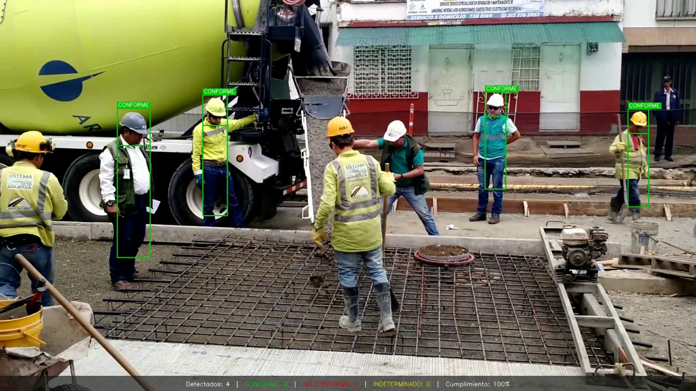
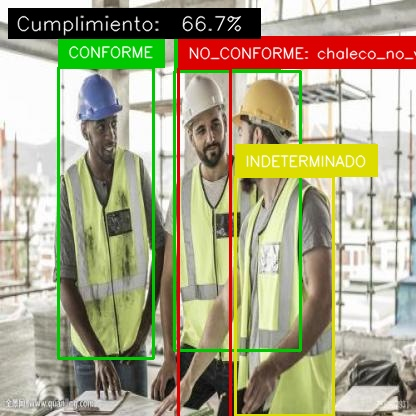
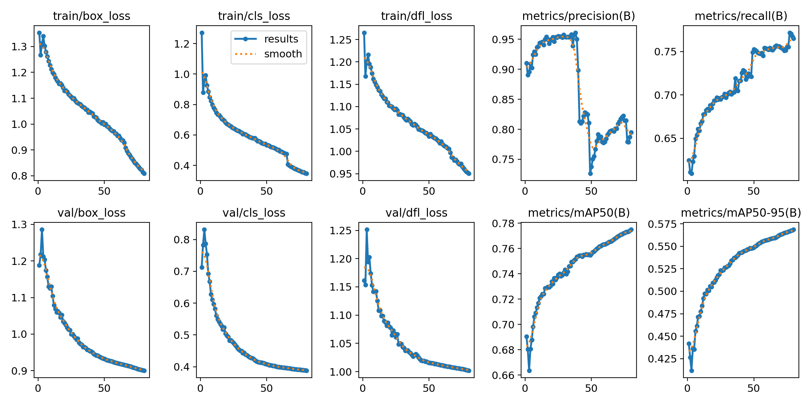

# Detección de cumplimiento de EPP en obras con YOLOv8

Sistema de visión por computador que **detecta a los trabajadores de una obra y verifica si usan casco de seguridad**. Un detector **YOLOv8s** ajustado al dominio se encarga de la percepción, y un **verificador determinista** emite un veredicto por trabajador: **CONFORME**, **NO CONFORME** o **INDETERMINADO**, este último cuando no hay evidencia suficiente para juzgar.

<p align="center">
  
</p>

## Resultados

Modelo final: YOLOv8s con `close_mosaic=15` (experimento D), evaluado sobre **3.895 imágenes de prueba nunca vistas**.

| Clase | mAP@0.5 | Precisión | Recall |
|---|---:|---:|---:|
| Cabeza con casco | **0,976** | 0,939 | 0,950 |
| Cabeza sin casco | **0,947** | 0,892 | 0,942 |
| Chaleco | **0,984** | 0,937 | 0,957 |
| Persona | 0,176 | 0,341 | 0,208 |
| **Global** | **0,771** | 0,777 | 0,765 |

- **Sin sobreajuste:** el mAP@0.5 en validación (0,775) y en prueba (0,771) es prácticamente el mismo, gracias a splits estratificados 70/15/15 sin fuga.
- **Video real no visto** (773 fotogramas, 1920×1080): **99,9 % de veredictos definitivos** con la regla final; solo 3 casos quedan como INDETERMINADO por oclusión real.
- **Robustez a la oclusión:** el mAP@0.5 baja de 0,779 (oclusión baja) a 0,704 (oclusión alta), y la métrica más afectada es el recall.
- **Calidad del código:** 29 pruebas unitarias del verificador con `pytest`.

## Cómo funciona

```
Imagen / video ─► YOLOv8s (5 clases) ─► verificador determinista ─► veredicto por trabajador + % de cumplimiento
                  cabeza con casco          ancla en la cabeza:          CONFORME · NO CONFORME ·
                  cabeza sin casco          ¿lleva casco?                INDETERMINADO
                  persona · chaleco
```

1. **Datos:** se unificaron 3 datasets públicos (SHWD, Safety Helmet Detection y PPE Detection) en una taxonomía de 5 clases, con validación visual y splits estratificados.
2. **Entrenamiento:** YOLOv8s en Kaggle (Tesla T4, 80 épocas por experimento). Se compararon 3 configuraciones: baseline, aumentación agresiva (Random Erasing + MixUp) y `close_mosaic=15`, que fue la ganadora.
3. **Verificación:** la lógica de negocio vive fuera del modelo, en código determinista y testeable. Así se puede auditar y cambiar la regla sin reentrenar.

## Hallazgos clave

- **Sesgo de etiquetado entre datasets.** Dos de los datasets solo anotan cabezas y el otro solo chalecos. El modelo aprendió ese patrón: **solo el 3 % de las imágenes tenía cabeza y chaleco detectados a la vez**, lo que dejaba el 27 % de los veredictos como INDETERMINADO.
- **Diagnóstico validado con evidencia.** Se probó el mismo verificador con un modelo externo entrenado sobre un dataset con anotación completa: produjo 2,75 veces más veredictos definitivos y bajó los INDETERMINADO de 27 % a 4 %. El problema estaba en los datos, no en la lógica.
- **Decisión de alcance.** Se redefinió la regla a **solo casco**, que además se ajusta a la realidad de las obras peruanas, donde el chaleco no es uniforme universal. Con ella, los veredictos definitivos pasaron a ser prácticamente el 100 %.
- **Ética:** el informe analiza la asimetría de errores (un falso negativo es más grave que un falso positivo), la privacidad de los trabajadores y los sesgos geográficos del dataset.

<p align="center">
  
  
</p>

## Documentación

- [Informe final](reports/informe_final.md), con metodología, experimentos, análisis de oclusión, ética y conclusiones.
- [Comparación de experimentos y métricas en prueba](reports/tables/baseline_metrics.md)
- [Validación del verificador](reports/tables/verifier_findings.md) y [comparación con un modelo externo](reports/tables/external_model_comparison.md)
- [Glosario de métricas](GLOSARIO_METRICAS.md)

**Equipo:** Efflyn Caja, José Chiroques y Jesús Nazario. Curso Redes Neuronales y Aprendizaje Profundo, Maestría en Inteligencia Artificial – UNI.

---

## Detalles técnicos y reproducibilidad

### Arquitectura híbrida local + Kaggle

El código vive en este repositorio Git. Los notebooks de Kaggle son delgados
y solo orquestan: clonan el repo, instalan dependencias e invocan funciones
del paquete `src/`.

| Componente | Dónde se ejecuta |
|---|---|
| Preparación de datos, remapeo, splits, análisis | Local |
| Verificador de cumplimiento y tests | Local |
| Entrenamiento e inferencia pesada | Kaggle (notebooks en [notebooks/kaggle/](notebooks/kaggle/)) |
| Datasets remapeados | Kaggle Datasets (una sola subida) |
| Checkpoints `.pt` | Releases de Git (NO commitear al repo) |

---

### Taxonomía unificada (5 clases)

| id | nombre              | significado                                           |
|----|---------------------|-------------------------------------------------------|
| 0  | head_with_helmet    | Cabeza con casco visible                              |
| 1  | head_without_helmet | Cabeza sin casco (clase crítica para cumplimiento)    |
| 2  | person              | Cuerpo completo o parcial del trabajador              |
| 3  | vest                | Chaleco reflectivo visible                            |
| 4  | no_vest_person      | Persona sin chaleco identificable                     |

La tabla de mapeo de cada dataset de origen hacia esta taxonomía está
versionada en [configs/class_mapping.yaml](configs/class_mapping.yaml).

---

### Requisitos del entorno

- **Python 3.11** (3.12 aún tiene problemas de wheels en algunas libs de visión).
- GPU NVIDIA con al menos 8 GB de VRAM **solo si se entrena localmente**.
  De lo contrario el entrenamiento corre en Kaggle.
- Git.

#### Instalación local

```powershell
# 1. Crear entorno virtual
python -m venv .venv
.\.venv\Scripts\Activate.ps1   # PowerShell
# o:  .\.venv\Scripts\activate.bat   # cmd
# o:  source .venv/bin/activate      # bash/zsh

# 2. Instalar dependencias
pip install --upgrade pip
pip install -r requirements.txt

# 3. (Opcional) Instalar el paquete src en modo editable
pip install -e .
```

> **PyTorch**: se instala como dependencia transitiva de Ultralytics. Si
> necesitas una variante específica con CUDA, instálala manualmente antes
> de `pip install -r requirements.txt` siguiendo
> https://pytorch.org/get-started/locally/.

#### Herramientas opcionales (fuera de `requirements.txt`)

| Herramienta | Para qué | Cómo instalar |
|---|---|---|
| **Weights & Biases** | Dashboards colaborativos de entrenamiento | `pip install wandb` |
| **CVAT** | Anotación profesional del 10% manual de oclusión | https://github.com/cvat-ai/cvat |
| **Label Studio** | Alternativa más ligera a CVAT | `pip install label-studio` |
| **ffmpeg** | Conversión y recortes del video demo final | https://ffmpeg.org/download.html |

---

### Datasets de origen

Los datasets **no se versionan** en el repositorio. Cada integrante los
descarga manualmente y los coloca en `data/raw/` siguiendo la estructura
documentada en [data/README.md](data/README.md).

| Dataset | Rol en el proyecto | Enlace |
|---|---|---|
| SHWD (Safety Helmet Wearing Dataset) | Negativos explícitos "sin casco" | https://github.com/njvisionpower/Safety-Helmet-Wearing-Dataset |
| Safety Helmet Detection (Roboflow) | Volumen y diversidad de escenas con casco | https://roboflow.com (Roboflow Universe) |
| PPE Detection (Roboflow) | Cobertura de chalecos | https://roboflow.com (Roboflow Universe) |

Licencias: SHWD según repositorio original; los de Roboflow Universe son
generalmente CC BY 4.0 (verificar al descargar).

---

### Orden de ejecución de scripts (Fase 1)

Todos los scripts viven en [src/data/](src/data/) y exponen `--help`.

```powershell
# 1. Remapear cada dataset original a la taxonomía unificada de 5 clases.
python -m src.data.remap_labels --dataset shwd      --src data/raw/shwd      --dst data/interim/shwd
python -m src.data.remap_labels --dataset helmet    --src data/raw/helmet    --dst data/interim/helmet
python -m src.data.remap_labels --dataset ppe       --src data/raw/ppe       --dst data/interim/ppe

# 2. Validar visualmente una muestra (mínimo 100 imágenes por dataset, plan fase 1).
python -m src.data.validate_visually --src data/interim/shwd   --n 100 --out reports/figures/validation_shwd
python -m src.data.validate_visually --src data/interim/helmet --n 100 --out reports/figures/validation_helmet
python -m src.data.validate_visually --src data/interim/ppe    --n 100 --out reports/figures/validation_ppe

# 3. Construir splits estratificados 70/15/15 sin fuga entre splits.
python -m src.data.make_splits --src data/interim --dst data/processed --ratios 0.70 0.15 0.15

# 4. Reportar distribución de clases por split.
python -m src.data.class_distribution_report --src data/processed --out reports/tables/class_distribution.csv
```

---

### Entrenamiento (Kaggle)

Cada experimento es un notebook delgado en [notebooks/kaggle/](notebooks/kaggle/).
La lógica vive en este repo; el notebook solo orquesta:

1. `01_baseline_train.ipynb` — YOLOv8s, 640, 50-80 epochs (Fase 2).
2. `02_exp_A_resolution.ipynb` — sube resolución a 960 (Fase 3, exp A).
3. `03_exp_B_augmentation.ipynb` — Random Erasing + MixUp (Fase 3, exp B).
4. `04_exp_C_class_weights.ipynb` — pesos / oversampling (Fase 3, exp C).
5. `05_exp_D_close_mosaic.ipynb` — `close_mosaic` últimos 15 epochs (Fase 3, exp D).
6. `06_inference_demo.ipynb` — pipeline YOLO + verificador sobre video (Fase 6).

Los checkpoints `.pt` se descargan del kernel y se publican como artefactos
en un **release de Git**, nunca commiteados al repositorio.

---

### Verificador de cumplimiento

Módulo en [src/compliance/](src/compliance/) que consume detecciones YOLO y
emite un veredicto por persona:

- **CONFORME**: casco + chaleco asociados correctamente.
- **NO_CONFORME**: falla casco o chaleco.
- **INDETERMINADO**: no se pudo asociar evidencia suficiente.

Visualización con bboxes verde / rojo / amarillo vía Supervision.
Tests con `pytest`:

```powershell
pytest tests/ -v
```

---

### Estructura del repositorio

```
.
├── configs/                # data.yaml, hyp_*.yaml, class_mapping.yaml
├── data/                   # gitignored salvo README
│   ├── raw/                # datasets originales sin tocar
│   ├── interim/            # tras remapeo
│   └── processed/          # tras splits, listo para Ultralytics
├── notebooks/kaggle/       # notebooks orquestadores
├── reports/                # tablas y figuras del informe
├── runs/                   # gitignored, salidas de Ultralytics
├── src/
│   ├── data/               # remap, splits, validación, reportes
│   └── compliance/         # geometría, verificador, renderer
├── tests/                  # pytest, casos sintéticos
├── .gitignore
├── pyproject.toml
├── requirements.txt
└── README.md
```

---

### Reproducibilidad

1. Clonar el repo.
2. Crear entorno con Python 3.11 e instalar `requirements.txt`.
3. Descargar los tres datasets desde los enlaces de arriba y colocarlos en
   `data/raw/` según [data/README.md](data/README.md).
4. Ejecutar los scripts de Fase 1 en el orden documentado.
5. Subir `data/processed/` como Kaggle Dataset y referenciarlo en los notebooks.
6. Ejecutar los notebooks en el orden 01 → 06.

---

### Alcance explícitamente NO incluido

- Tracking entre fotogramas (ByteTrack, SORT, DeepSORT).
- Re-identificación de trabajadores.
- Detección de arnés (mencionado como contextual en el enunciado).
- Generación de datos sintéticos.
- Etiquetado manual de imágenes nuevas.
- Despliegue en tiempo real o hardware embebido.

